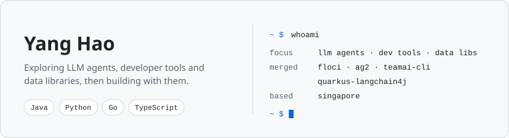

<a href="https://github.com/Assertive-xxh">
  <picture>
    <source media="(prefers-color-scheme: dark)" srcset="assets/header-dark.svg">
    
  </picture>
</a>

<table>
<tr>
<td valign="top" width="50%">

**Building**

[zzu-hos](https://github.com/Assertive-xxh/zzu-hos): an LLM assistant for a university clinic. RAG over clinic documents, booking through tool calls.

</td>
<td valign="top" width="50%">

**Contributing to**

[AG2](https://github.com/ag2ai/ag2) · [Floci](https://github.com/floci-io/floci) · [Quarkus LangChain4j](https://github.com/quarkiverse/quarkus-langchain4j) · [TeamAI CLI](https://github.com/Tencent/teamai-cli) 
<a href="https://github.com/search?q=author%3AAssertive-xxh+is%3Apr+is%3Amerged&type=pullrequests">See merged pull requests →</a>

</td>
</tr>
</table>

<samp><a href="mailto:1994728136@qq.com">1994728136@qq.com</a></samp>

